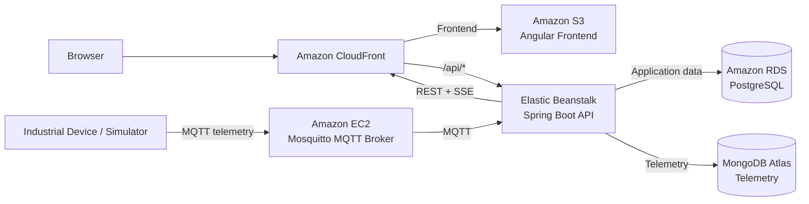

# EnerSense

EnerSense is a full-stack industrial IoT monitoring platform for managing facilities and devices, ingesting telemetry through MQTT, evaluating configurable threshold rules, generating alerts, and delivering live monitoring updates through an Angular dashboard.

The project demonstrates an end-to-end event-driven architecture using Java, Spring Boot, Angular, PostgreSQL, MongoDB, MQTT, Server-Sent Events, AWS, and MongoDB Atlas.

## Features

- JWT authentication
- Role-based access control with ADMIN and OPERATOR roles
- Facility management
- Device management
- Threshold rule configuration
- Automatic alert generation
- Alert acknowledgement
- MQTT telemetry ingestion
- Simulated industrial telemetry
- MongoDB telemetry storage
- PostgreSQL application data
- Real-time Server-Sent Events
- Live Angular dashboard
- Telemetry charts
- Reactive forms
- Automated backend tests
- JaCoCo code coverage
- Backend and frontend GitHub Actions CI
- Production cloud deployment

## Technology Stack

### Backend

- Java 21
- Spring Boot 4
- Spring Security
- OAuth2 Resource Server
- JWT
- Spring Data JPA
- Spring Data MongoDB
- Spring Integration MQTT
- Maven

### Frontend

- Angular
- TypeScript
- RxJS
- Chart.js
- Reactive Forms

### Data and Messaging

- PostgreSQL
- MongoDB Atlas
- MQTT
- Eclipse Mosquitto

### Cloud

- AWS Elastic Beanstalk
- Amazon EC2
- Amazon RDS
- Amazon S3
- Amazon CloudFront
- MongoDB Atlas

### Testing and CI

- JUnit 5
- Mockito
- Spring Security Test
- JaCoCo
- GitHub Actions

## Production Architecture

EnerSense is deployed using a multi-service AWS architecture.



CloudFront provides a single public origin for both the Angular frontend and `/api/*` backend requests.

This allows the frontend to communicate with the backend using relative API URLs while avoiding mixed-content and cross-origin issues.

## Telemetry Flow

Devices publish telemetry using the topic format:

```text
enersense/devices/{deviceId}/telemetry
```

Example payload:

```json
{
  "power": 1250.0,
  "voltage": 230.0,
  "current": 5.4,
  "temperature": 42.5
}
```

The backend then:

1. Receives the message through the Mosquitto MQTT broker.
2. Extracts the device ID from the MQTT topic.
3. Parses the JSON telemetry payload.
4. Validates the device.
5. Stores the telemetry measurement in MongoDB Atlas.
6. Evaluates active threshold rules.
7. Generates alerts when thresholds are violated.
8. Pushes live telemetry and alert events to the Angular frontend using Server-Sent Events.

The production deployment has been validated end-to-end with live MQTT telemetry and real-time dashboard updates without browser refresh.

## Threshold Monitoring

Threshold rules can be configured for:

- Power
- Voltage
- Current
- Temperature

Supported comparison operators include:

- Greater than
- Greater than or equal
- Less than
- Less than or equal

Rules can generate:

- WARNING alerts
- CRITICAL alerts

For example, a temperature threshold can automatically generate a CRITICAL alert when a device reading exceeds the configured limit.

## Data Storage

EnerSense uses two different database technologies for different workloads.

### PostgreSQL

Amazon RDS PostgreSQL stores structured application data:

- Users
- Facilities
- Devices
- Threshold rules
- Alerts

### MongoDB

MongoDB Atlas stores time-oriented telemetry measurements.

This polyglot persistence approach keeps operational relational data separate from high-frequency telemetry data.

## Authentication and Authorization

The backend uses JWT-based stateless authentication.

### ADMIN

Administrators can:

- Manage users
- Create facilities
- Create devices
- Configure threshold rules
- View telemetry
- View alerts
- Acknowledge alerts

### OPERATOR

Operators can:

- View facilities and devices
- View telemetry
- View alerts
- Acknowledge alerts

Administrative modification endpoints remain restricted to ADMIN users.

## Real-Time Updates

EnerSense uses Server-Sent Events to push new telemetry and alerts from the Spring Boot backend to the Angular frontend.

This allows the dashboard to update live without page refreshes or client-side polling.

The production SSE flow has been verified through CloudFront.

## Health Endpoint

The backend exposes a lightweight public health endpoint:

```http
GET /
```

Example response:

```json
{
  "status": "ok",
  "service": "EnerSense API"
}
```

This is used to verify that the deployed Spring Boot application is available.

## Testing

The backend contains automated unit, service, MQTT, security, authorization, and business-rule tests.

Tested areas include:

- Authentication
- Role authorization
- Facilities
- Devices
- Users
- Threshold rules
- Alert evaluation
- Alerts
- Telemetry
- MQTT processing
- Server-Sent Events

Run the backend tests on Windows:

```powershell
.\mvnw.cmd clean test
```

Linux/macOS:

```bash
./mvnw clean test
```

## Code Coverage

JaCoCo is used for backend coverage reporting.

Current backend coverage is approximately:

- Instruction coverage: 67%
- Branch coverage: 56%

Core package coverage includes:

- Alerts: 90%
- Realtime / SSE: 89%
- Security: 89%
- Users: 86%
- Devices: 83%
- Telemetry: 82%
- Threshold rules: 82%
- Facilities: 82%
- Authentication: 66%
- MQTT: 58%

Generate the report on Windows:

```powershell
.\mvnw.cmd clean test
start target\site\jacoco\index.html
```

Report location:

```text
target/site/jacoco/index.html
```

## Continuous Integration

GitHub Actions provides separate backend and frontend CI pipelines.

### Backend CI

The backend workflow:

1. Checks out the repository.
2. Configures Java 21.
3. Restores Maven dependencies.
4. Runs the complete Maven test suite.

### Frontend CI

The frontend workflow:

1. Checks out the repository.
2. Configures Node.js.
3. Installs dependencies using `npm ci`.
4. Runs the Angular production build.

Both pipelines run automatically on pushes and pull requests targeting `main`.

## Production Configuration

Sensitive production values are supplied through environment variables and are not stored in source control.

Production configuration includes:

```text
SPRING_PROFILES_ACTIVE
ENERSENSE_DB_URL
ENERSENSE_DB_USERNAME
ENERSENSE_DB_PASSWORD
ENERSENSE_MONGODB_URI
ENERSENSE_MQTT_BROKER
ENERSENSE_MQTT_CLIENT_ID
ENERSENSE_MQTT_TOPIC
ENERSENSE_JWT_SECRET
PORT
```

Credentials and secrets must never be committed to the repository.

## Local Development

Local development requires:

- Java 21
- Node.js
- PostgreSQL
- MongoDB
- Eclipse Mosquitto

Run the backend:

```powershell
.\mvnw.cmd spring-boot:run
```

Run the Angular frontend:

```powershell
cd enersense-ui
npm.cmd install
npm.cmd start
```

The Angular development proxy forwards `/api` requests to the local Spring Boot application.

## Project Structure

```text
enersense-api/
│
├── .github/
│   └── workflows/
│
├── enersense-ui/
│   └── Angular frontend
│
├── src/
│   ├── main/
│   │   ├── java/
│   │   │   └── com/gepapant/enersense/
│   │   │       ├── alert/
│   │   │       ├── auth/
│   │   │       ├── device/
│   │   │       ├── facility/
│   │   │       ├── health/
│   │   │       ├── mqtt/
│   │   │       ├── realtime/
│   │   │       ├── security/
│   │   │       ├── simulator/
│   │   │       ├── telemetry/
│   │   │       ├── threshold/
│   │   │       └── user/
│   │   └── resources/
│   └── test/
│
├── mqtt-payload.json
├── mvnw
├── mvnw.cmd
├── pom.xml
└── README.md
```

## Production Validation

The complete production pipeline has been successfully validated:

```text
MQTT Publisher
      ↓
Mosquitto on Amazon EC2
      ↓
Spring Boot on Elastic Beanstalk
      ↓
MongoDB Atlas
      ↓
Threshold Evaluation
      ↓
Alert Generation
      ↓
Server-Sent Events
      ↓
Angular Dashboard through CloudFront
```

Validated production functionality includes:

- Authentication
- Facility creation
- Device creation
- MQTT telemetry ingestion
- MongoDB persistence
- Live dashboard telemetry
- Server-Sent Events without refresh
- Threshold evaluation
- Automatic CRITICAL alert generation

## Development Status

**Production MVP complete.**

EnerSense now includes the complete application stack, automated CI pipelines, cloud infrastructure, real-time telemetry processing, and production deployment.

Future improvements may include:

- Device provisioning
- Historical telemetry filtering
- Advanced analytics
- Additional alert channels
- TLS-secured MQTT
- Infrastructure as Code
- Containerized deployment

## Author

George Papantoniou

GitHub: [gepapant](https://github.com/gepapant)