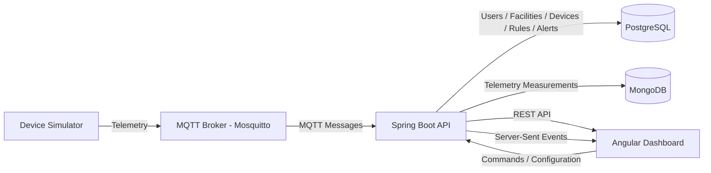

# EnerSense

EnerSense is a full-stack industrial monitoring application for managing facilities and devices, receiving simulated telemetry through MQTT, evaluating threshold rules, generating alerts, and displaying live updates in an Angular dashboard.

The project demonstrates a practical event-driven monitoring architecture using Java, Spring Boot, Angular, PostgreSQL, MongoDB, MQTT, and Server-Sent Events.

## Features

- JWT authentication
- Role-based access control with ADMIN and OPERATOR roles
- Facility management
- Device management
- Threshold rule configuration
- Automatic alert generation
- Alert acknowledgement
- MQTT telemetry ingestion
- Simulated industrial device telemetry
- MongoDB telemetry storage
- PostgreSQL application data
- Live telemetry updates through Server-Sent Events
- Angular dashboard with charts and reactive forms
- Automated backend tests
- JaCoCo code coverage
- GitHub Actions CI

## Technology Stack

### Backend

- Java 21
- Spring Boot
- Spring Security
- Spring Data JPA
- Spring Data MongoDB
- Spring Integration MQTT
- Maven
- JWT authentication

### Frontend

- Angular
- TypeScript
- RxJS
- Chart.js
- Reactive Forms

### Data and Messaging

- PostgreSQL
- MongoDB
- MQTT
- Eclipse Mosquitto

### Testing and CI

- JUnit 5
- Mockito
- Spring Security Test
- JaCoCo
- GitHub Actions

## Architecture



## Telemetry Flow

A simulated device publishes telemetry to an MQTT topic:

```text
enersense/devices/{deviceId}/telemetry
```

Example payload:

```json
{
  "power": 2100,
  "voltage": 230,
  "current": 9.1,
  "temperature": 84
}
```

The Spring Boot backend:

1. Receives the MQTT message.
2. Extracts the device ID from the topic.
3. Parses and validates the telemetry payload.
4. Stores the measurement in MongoDB.
5. Evaluates active threshold rules.
6. Creates alerts when a rule is violated.
7. Publishes live telemetry and alerts to the frontend through Server-Sent Events.

## Data Storage

EnerSense uses two databases for different workloads.

### PostgreSQL

Stores structured application data:

- Users
- Facilities
- Devices
- Threshold rules
- Alerts

### MongoDB

Stores time-oriented telemetry measurements generated by devices.

This separates operational application records from telemetry data.

## Authentication and Authorization

The backend uses JWT-based authentication.

### ADMIN

Administrators can:

- Manage users
- Create facilities
- Create devices
- Create and modify threshold rules
- View telemetry
- View alerts
- Acknowledge alerts

### OPERATOR

Operators can:

- View facilities and devices
- View telemetry
- View alerts
- Acknowledge alerts

Administrative modification endpoints remain restricted to ADMIN users.

## Testing

The backend contains automated unit and authorization tests covering the main application services and business rules.

Tested areas include:

- Authentication
- Security and role authorization
- Facilities
- Devices
- Users
- Threshold rules
- Alert evaluation
- Alerts
- Telemetry
- MQTT message processing
- Server-Sent Events

Run the complete backend test suite on Windows:

```powershell
.\mvnw.cmd clean test
```

On Linux or macOS:

```bash
./mvnw clean test
```

## Code Coverage

JaCoCo is used for backend coverage reporting.

Current backend coverage:

- Instruction coverage: approximately 67%
- Branch coverage: approximately 56%

Core packages currently include:

- Alerts: 90%
- Realtime / SSE: 89%
- Security: 89%
- Users: 86%
- Devices: 83%
- Telemetry: 82%
- Threshold rules: 82%
- Facilities: 82%
- Authentication: 66%
- MQTT: 58%

The device simulator is intentionally not the main focus of unit testing because it is supporting simulation code rather than core application business logic.

Generate and open the coverage report on Windows with:

```powershell
.\mvnw.cmd clean test
start target\site\jacoco\index.html
```

The generated report is located at:

```text
target/site/jacoco/index.html
```

## Continuous Integration

GitHub Actions runs the backend Maven test suite automatically on pushes and pull requests.

The backend CI pipeline:

1. Checks out the repository.
2. Configures Java 21.
3. Restores the Maven dependency cache.
4. Runs the complete Maven test suite.

## Local Configuration

Sensitive values are not stored directly in source control.

Required environment variables include:

```text
ENERSENSE_DB_PASSWORD
ENERSENSE_JWT_SECRET
```

The application also requires the following local services:

- PostgreSQL
- MongoDB
- Eclipse Mosquitto

## Project Structure

```text
enersense-api/
│
├── .github/
│   └── workflows/
│
├── enersense-ui/
│   └── Angular frontend
│
├── src/
│   ├── main/
│   │   ├── java/
│   │   │   └── com/gepapant/enersense/
│   │   │       ├── alert/
│   │   │       ├── auth/
│   │   │       ├── device/
│   │   │       ├── facility/
│   │   │       ├── mqtt/
│   │   │       ├── realtime/
│   │   │       ├── security/
│   │   │       ├── simulator/
│   │   │       ├── telemetry/
│   │   │       ├── threshold/
│   │   │       └── user/
│   │   │
│   │   └── resources/
│   │
│   └── test/
│       └── java/
│
├── mqtt-payload.json
├── mvnw
├── mvnw.cmd
├── pom.xml
└── README.md
```

## Deployment

EnerSense is currently being prepared for cloud deployment.

Unlike smaller portfolio applications deployed through simple frontend/backend hosting platforms, the goal for EnerSense is to deploy the complete system using a more realistic cloud architecture.

The deployment architecture will include:

- Angular frontend
- Spring Boot backend
- PostgreSQL
- MongoDB
- MQTT broker
- Environment-based secrets
- Automated CI
- REST API communication
- Live Server-Sent Events

The target cloud platform will be Azure or AWS.

Docker is not required for the initial deployment phase.

## Development Status

### Completed

- Spring Boot REST API
- PostgreSQL persistence
- MongoDB telemetry storage
- JWT authentication
- Role-based authorization
- Facility management
- Device management
- Threshold rule management
- Alert generation
- Alert acknowledgement
- MQTT ingestion
- Device simulator
- Server-Sent Events
- Angular dashboard
- Live telemetry charts
- Backend automated tests
- JaCoCo coverage
- Backend GitHub Actions CI

### Next Steps

- Frontend GitHub Actions CI
- Cloud deployment
- Deployment configuration for PostgreSQL, MongoDB, and MQTT
- Production environment configuration
- Repository screenshots
- Final portfolio presentation

## Author

George Papantoniou

GitHub: [gepapant](https://github.com/gepapant)